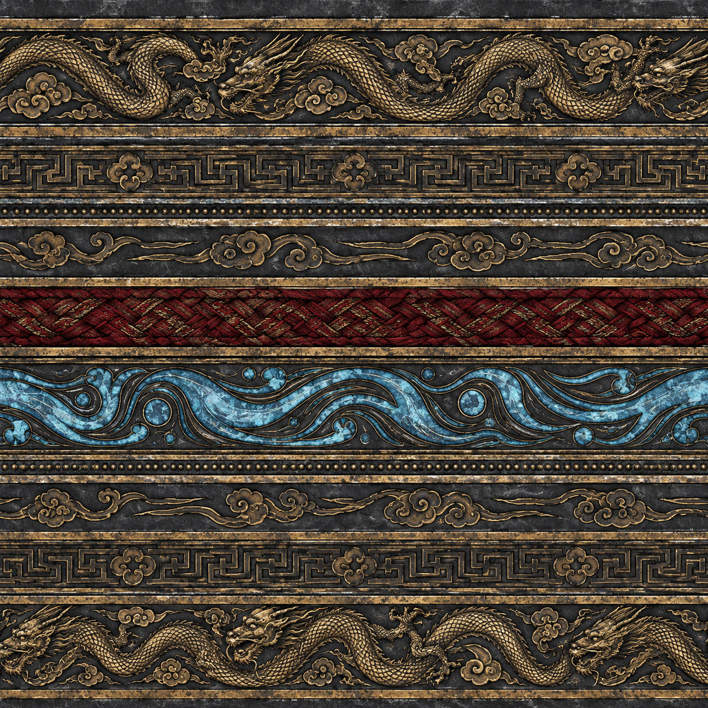
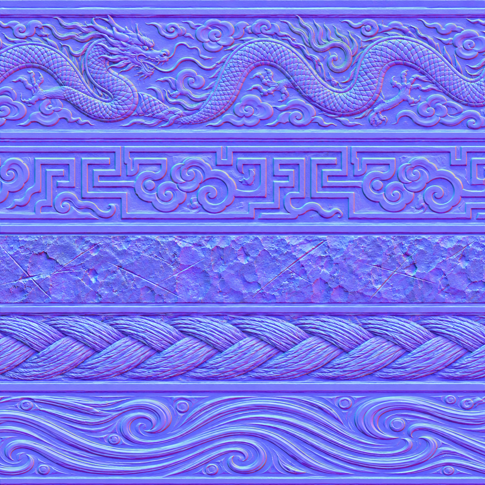
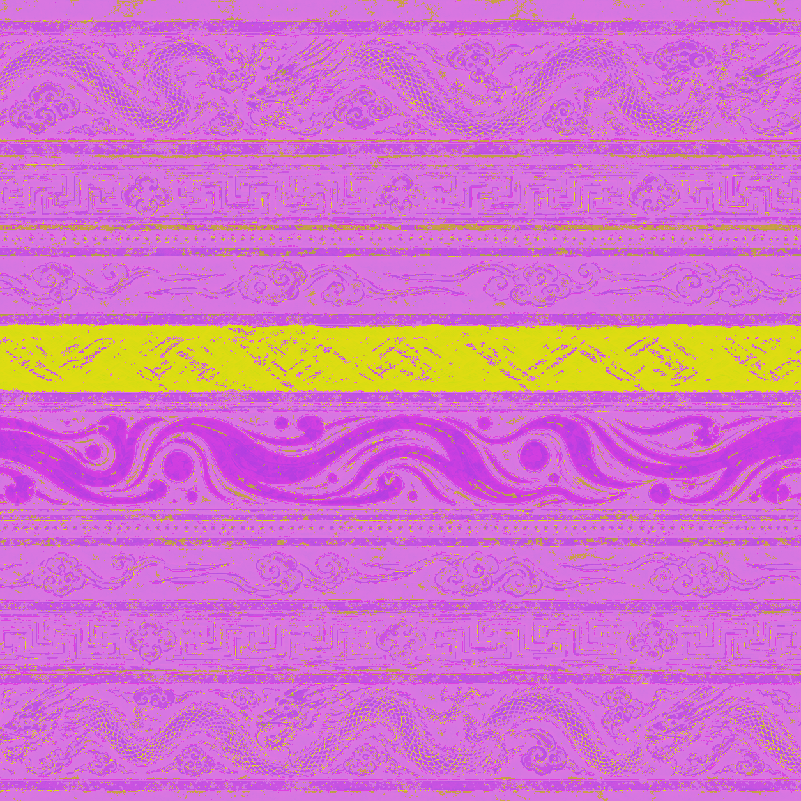

# 原创武器 PBR 交付

该贴图组由项目内原创描述生成，并经过技术通道整理；未使用或解包任何商业游戏资产。纹样只借用通用的中国传统云雷、流水、蟠龙和编绳语汇。

## BaseColor

文件：`assets/textures/weapons/mythic-metal-basecolor.png`，1254 × 1254，sRGB。

## Normal

文件：`assets/textures/weapons/mythic-metal-normal.png`，1254 × 1254，Tangent Space，Linear，运行时 `normalScale = (0.55, 0.55)`。

## ORM

文件：`assets/textures/weapons/mythic-metal-orm.png`，1254 × 1254，Linear。通道定义：R = Ambient Occlusion，G = Roughness，B = Metalness。

## Three.js 材质参数

| 部位 | metalness | roughness | emissive |
| --- | ---: | ---: | --- |
| 冰蓝剑身 | 0.82 | 0.16 | `#155e9a`，技能期增强 |
| 银白吞口 | 0.92 | 0.22 | 无 |
| 暗金纹饰 | 0.94 | 0.26 | 低血量时增强 |
| 玄铁传承物 | 0.80 | 0.34 | 无 |
| 深红锦绳 | 0.00 | 0.92 | 无 |

场景 PBR 在 `src/world/pbrMaterials.js` 中以同样的 BaseColor / Normal / ORM 结构运行；石面粗糙度 0.72、苔痕 0.90、旧木 0.82、竹面 0.64、绳索 0.94、水面 0.20 + clearcoat 1.0。
